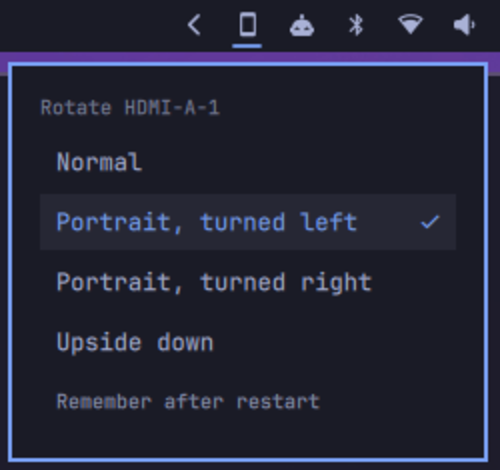

# Screen Rotate

One-click monitor rotation from the Omarchy bar. Click the icon, pick
**Normal**, **Portrait, turned left**, **Portrait, turned right** or **Upside
down**, and the screen the bar is on rotates.



- Plain-English choices in a fixed order, with the current rotation highlighted
- Works per monitor: each bar rotates its own screen
- Icon shows the orientation at a glance (monitor = landscape, phone = portrait)
- Keeps your monitor's resolution, refresh rate, position and scale
- Optional "Remember after restart", only touches your config when you ask
- Plain shell helper you can also run from a terminal or bind to a key

## Compatibility

Rotation is done by Hyprland (the monitor `transform`), not by the monitor, so it
works with **any monitor Hyprland drives**: external monitors over HDMI,
DisplayPort or USB-C, and laptop panels. The monitor needs no rotation support of
its own; pivot it physically to match.

Tested on Omarchy 4.0 (Hyprland 0.56, Quickshell 0.3) with a Dell U2719DC over
HDMI. Things to know:

- **Laptops and 2-in-1s:** the screen rotates, but touchscreens and pens are not
  remapped and there's no accelerometer auto-rotate. For convertibles, use
  [Display with Rotation](https://github.com/yeutterg/omarchy-display-rotation)
  or [omarchy-tablet-mode](https://github.com/zangzh17/omarchy-tablet-mode).
- **Several monitors:** rotating swaps a screen's width and height. With
  `position = "auto"` Hyprland re-arranges for you; with fixed positions in
  `monitors.lua`, a neighbour may need its position adjusted.
- **Mirrored monitors** aren't handled specially.

## Requirements

Omarchy 4 (Quattro) with the built-in bar. Uses `bash`, `hyprctl` and `jq`, which
Omarchy already ships. No sudo, no network, no extra packages.

## Install

```bash
omarchy plugin add https://github.com/vivek/omarchy-screen-rotate --enable
```

The icon lands on the right side of the bar. To place it somewhere else, e.g.
right after the tray:

```bash
omarchy plugin enable io.github.vivek.screen-rotate --section right --after omarchy.tray
```

## Usage

Click the icon and pick a rotation. Click outside the popup, or the icon again,
to close it. Hovering the icon shows the monitor and its current rotation.

### Remember after restart

Out of the box a rotation lasts until Hyprland restarts (logout, reboot or
config reload). To keep it, click **Remember after restart** at the bottom of the
popup (it disappears once set up). This:

1. backs up `~/.config/hypr/monitors.lua` to `monitors.lua.bak.<timestamp>`
2. appends one line to it:
   ```lua
   pcall(require, "hypr.screen-rotate")
   ```
3. saves rotated monitors in `~/.config/hypr/screen-rotate.lua`

From then on each rotation is saved; rotating back to **Normal** removes the
monitor from the file. Nothing else in your config is changed. The `pcall` means
Hyprland starts fine even if the file is gone.

Saved entries record the monitor's mode, position and scale at the time you
rotated it. If you later change those in `monitors.lua`, rotate that monitor to
Normal and back to refresh its entry.

### Keyboard shortcut

The widget answers IPC, so you can open the popup on the focused monitor from a
keybinding, e.g. in `~/.config/hypr/bindings.lua`:

```lua
o.bind("SUPER + CTRL + R", "Rotate screen", "omarchy-shell io.github.vivek.screen-rotate open")
```

IPC methods: `open`, `close`, `refresh`.

### Command line

The helper the widget uses works on its own:

```bash
helper=~/.config/omarchy/plugins/io.github.vivek.screen-rotate/bin/screen-rotate

$helper list                 # monitors and their rotation
$helper set HDMI-A-1 3       # 0 Normal, 1 Portrait turned right, 2 Upside down, 3 Portrait turned left
$helper get HDMI-A-1         # "<transform> <saved>"
$helper setup                # same as "Remember after restart"
$helper forget               # undo setup and drop saved rotations
```

Run `omarchy-shell io.github.vivek.screen-rotate refresh` afterwards to update the
icon straight away (it also refreshes the next time you open the popup).

## Update

```bash
omarchy plugin update io.github.vivek.screen-rotate
omarchy-restart-shell
```

The restart makes sure the shell picks up the new QML instead of a cached copy.

## Uninstall

If you used **Remember after restart**, drop the saved rotations first, while the
helper is still installed:

```bash
bash ~/.config/omarchy/plugins/io.github.vivek.screen-rotate/bin/screen-rotate forget
```

Then remove the plugin:

```bash
omarchy plugin remove io.github.vivek.screen-rotate
```

`forget` deletes `~/.config/hypr/screen-rotate.lua` and the one line it added to
`monitors.lua`. The screen stays as it is until Hyprland restarts, then follows
`monitors.lua` again. If you already removed the plugin, delete those two by hand;
the line is harmless if left behind.

## How it works

- `Widget.qml`: the bar icon and popup, built from Omarchy's `BarWidget`,
  `BarIconButton` and `PopupCard`, so it follows your theme. It reads the
  monitor name from the bar window it sits in.
- `bin/screen-rotate`: reads the monitor's live mode, position and scale from
  `hyprctl monitors -j`, applies the new transform with
  `hyprctl eval 'hl.monitor({ ... })'`, and, if set up, writes the same call to
  `~/.config/hypr/screen-rotate.lua`.

## Troubleshooting

- **Icon doesn't appear:** `omarchy plugin list` should show it enabled. Check
  `journalctl -b | grep screen-rotate` for QML errors, then run
  `omarchy-restart-shell`.
- **Rotation resets after logout:** use **Remember after restart**, or check that
  `monitors.lua` still has the `pcall(require, "hypr.screen-rotate")` line.
- **Wrong direction:** "turned left/right" describes which way you turned the
  monitor. If yours looks upside down, pick the other portrait option.

## Related plugins

If you want a full display manager (arrangement, resolution, scale and rotation),
see [omarchy-displays](https://github.com/kimm-stensborg/omarchy-displays).
Screen Rotate does one thing: quick rotation from the bar.

## License

[MIT](LICENSE)
